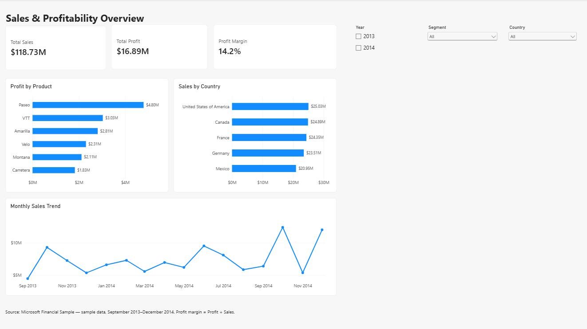
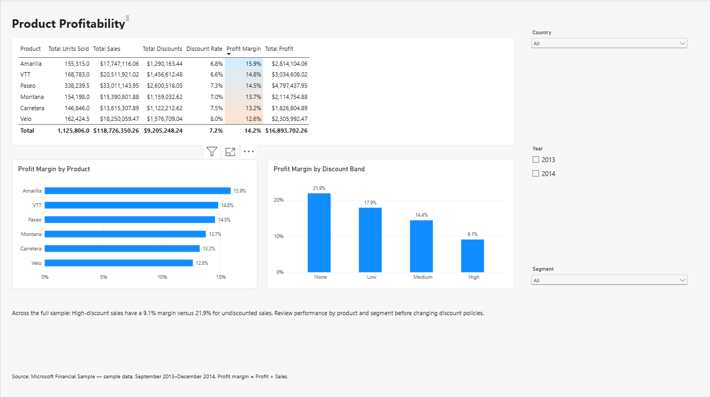
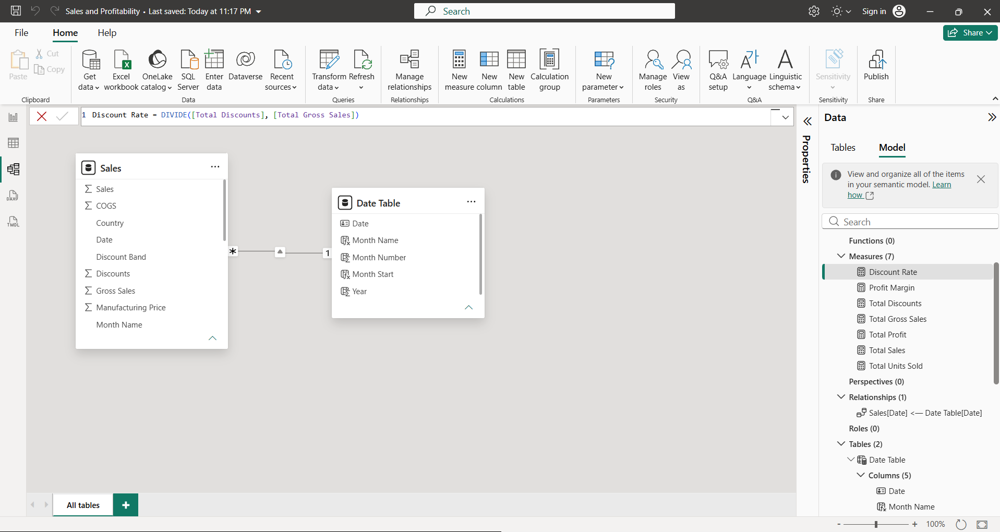

# powerbi-sales-profitability
Power BI portfolio project analysing sales, product profitability, and discount patterns using Microsoft Financial Sample data.
# Sales & Profitability Analysis | Power BI

A two-page interactive report exploring sales performance, product profitability, and discount patterns using Microsoft Financial Sample data.

## Dashboard Preview

## Business Questions

- Which products generate the most profit?
- Which products have the highest profit margins?
- How do sales vary across countries and months?
- How does profitability differ across discount bands?

## Tools and Skills

- Power BI Desktop
- Power Query: text cleaning and data type preparation
- DAX: aggregate measures and financial ratios
- Data modelling: a dedicated Date table with an active one-to-many relationship to Sales
- Interactive slicers, tooltips, and conditional formatting

## Report Pages

**Sales Overview:** Sales, profit, and margin cards; product profit rankings; country sales; and monthly sales trends.

**Product Analysis:** Product comparison table, profit margins by product, and margins by discount band.

Both pages support filtering by year, country, and segment.

## Key Results

Across the full sample:

- Total sales: $118.73 million
- Total profit: $16.89 million
- Profit margin: 14.2%

## Findings and Suggested Actions

1. **Paseo generates the highest total profit:** $4.80 million from $33.01 million in sales, at a 14.5% margin. Monitor its contribution across countries and segments.

2. **Amarilla has the highest product margin:** 15.9%, generating $2.81 million in profit. Investigate opportunities to grow its sales while maintaining profitability.

3. **High-discount sales have lower margins:** 9.1%, compared with 21.9% for undiscounted sales—a difference of 12.8 percentage points. Review product and segment differences before changing discount policies.

## Core DAX Measures

    Profit Margin = DIVIDE([Total Profit], [Total Sales])

    Discount Rate = DIVIDE([Total Discounts], [Total Gross Sales])

These ratios use aggregated totals rather than averaging row-level percentages.

## Data Model

The Date table filters Sales through an active one-to-many relationship on Date.

## Repository Contents

- Report: Power BI (.pbix) file and PDF preview
- Screenshots: report pages and data model
- Data: source Excel workbook

## How to Explore

1. Download the repository using Code → Download ZIP.
2. Extract the ZIP.
3. Open the .pbix file in Power BI Desktop.
4. To refresh, open Data source settings → Change Source and select the Excel workbook in the Data folder.
5. Use the slicers and hover over chart values to explore the report.

The PDF and screenshots provide static previews; interactive features require the Power BI file.

## Source and Limitations

Source: Microsoft Financial Sample.
https://learn.microsoft.com/en-us/power-bi/create-reports/sample-financial-download

- This is sample data used for a portfolio project.
- The data covers September 2013–December 2014; 2013 is a partial year, so full-year totals are not directly comparable.
- Discount-band comparisons show associations and do not establish causation.
- The insight text on Product Analysis describes the full sample and remains fixed when filters change.
- Recommendations are proposals for further investigation, not measured business outcomes.
